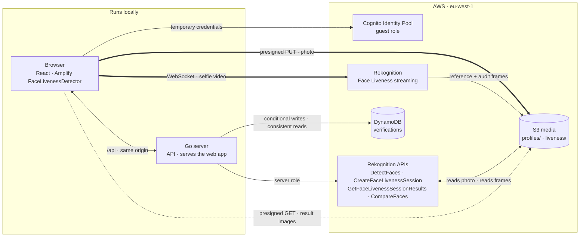
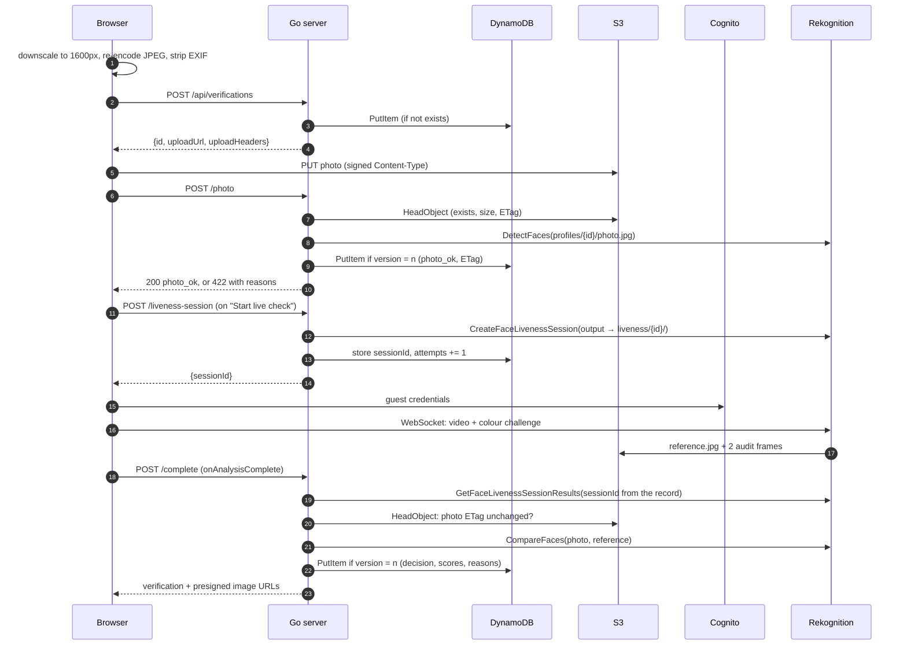

# Selfie Verification with Rekognition Face Liveness

"Is this really you?" photo verification, like the verified badge on a dating profile. A person uploads a profile photo, then does a ten-second live check with their camera. The live check streams video straight from the browser to Amazon Rekognition Face Liveness, which judges whether a real person was in front of the camera. A Go server then compares the live face with the photo and approves, sends for manual review, or rejects, always with reasons. Every decision is made on the server from data it fetched itself, so nothing the browser reports is trusted.

**Stack:** Go · React + TypeScript (Vite) with Amplify `FaceLivenessDetector` · AWS (Rekognition, S3, DynamoDB, Cognito Identity Pools, IAM) · Terraform


## The problem

Profile photos lie. A verified badge is only worth something if it proves two things: that **a real person** was in front of the camera (not a printed photo, a screen, or a replayed video), and that **it's the same person** as in the profile photo.

The requirements I designed for:

- **Spoof-resistant.** Holding a phone up to the camera must not pass. A home-made "turn your head left" check can be beaten by a video. Face Liveness is much harder to fool, because it projects a random colour sequence onto the face and checks the reflection.
- **Untrusted client.** Anything the browser says, including "liveness passed", can be forged. The decision has to come from data the server fetches itself.
- **Mostly phones.** People do this on a phone, a little self-conscious about being on camera. The flow has to be quick, plain, and work at 360px wide.
- **Biometric data is a liability.** Keep as little as possible, for as short a time as possible, and make deletion real.

## How I think about it

1. **The server decides.** The browser's "analysis complete" callback only means "go ask the server". The server reads the liveness result for the session *it* stored on the record, runs the face comparison itself, and applies its own thresholds. The client never sends a score, a session ID to trust, or an S3 key.

2. **Bytes don't go through the server.** The photo goes from the browser straight to S3 with a presigned URL. The video goes straight to Rekognition over a WebSocket. The Go server only signs, orchestrates and decides, so it stays small and could run anywhere.

3. **Interfaces at every AWS edge.** S3, Rekognition and DynamoDB each sit behind a small Go interface with an in-memory fake. The whole flow runs and is tested without AWS. A shared contract suite keeps the DynamoDB store and its fake behaving the same.

4. **Every write is conditional.** Records carry a version, and every update succeeds only if nobody else saved first. Double clicks and racing requests can't overwrite each other or record two decisions.

5. **Explain, don't just announce.** The API returns scores, thresholds and reason codes, not just a status. The UI shows each score against its pass mark and turns each reason code into a sentence that says what to do.

6. **Short-lived by default.** Every object and record has a 7-day expiry, versioning is off so deletes are real, and the photo is stripped of metadata before it leaves the phone.

## Architecture



The one non-obvious arrow is the video stream. It goes from the browser to Rekognition directly, never through the Go server. That's why the server can run on a laptop, and why the browser needs its own AWS credentials. It gets them from a Cognito identity pool, for a role whose only permission is `rekognition:StartFaceLivenessSession`. Those credentials are useless without a session ID, and only the server can create one.

## End-to-end flow



### Stage by stage

**1. Photo.** The person picks a photo, drags one in, or takes a selfie. Before upload, the browser draws it onto a canvas capped at 1600px on the long edge and re-encodes it as JPEG at 0.9. A 5–12 MB phone photo becomes a few hundred KB, every upload has the one content type the server signs for, and EXIF data (including GPS) is dropped. The server creates the record and signs a 5-minute PUT URL for `profiles/{id}/photo.jpg`, built from the ID. The browser uploads straight to S3.

**2. Photo check.** `DetectFaces` must find exactly one face (weak detections such as a poster in the background don't count) at 99% confidence or more. The face must be roughly frontal (yaw and pitch within ±30°), sharp enough and bright enough. All problems are reported at once, so a single new photo can fix them. The server records the photo's ETag at this point.

**3. Live check.** A session is created only when the person presses **Start live check**, because sessions expire 3 minutes after creation. Each verification allows 3 sessions, and a retry always gets a new one. The Amplify component opens the camera, guides the face into the oval, flashes a colour sequence, and streams it all to Rekognition. Rekognition writes a reference frame and two audit frames under `liveness/{id}/{sessionId}/`.

**4. Decision.** The server fetches the result for the session stored on the record and accepts the reference image only if it's under this verification's own prefix. It re-checks the photo's ETag, because the upload URL was still valid after the photo check, then runs `CompareFaces` and applies the thresholds. The result comes back with fresh 10-minute presigned URLs for both images, so the result screen shows them side by side with each score against its pass mark.

## Design decisions and trade-offs

### Cognito guest credentials for the browser
The stream must be signed with AWS credentials, and a browser can never hold long-lived keys. A Cognito identity pool with guest access hands out credentials for about an hour. The role's only permission is `rekognition:StartFaceLivenessSession`, which is useless without a session ID that only the server can create. Guest access keeps the demo free of sign-up. A production version would use authenticated identities tied to the app's own login.

### Presigned upload and client-side downscaling
Uploading through the API server would cost bandwidth and memory for nothing. With a presigned URL, the server signs one exact request (method, key, `Content-Type`, 5-minute expiry) and the browser sends it to S3. Downscaling in the browser makes the upload fast on a phone and guarantees a JPEG. **Trade-off:** S3 needs a CORS rule for every origin the page is served from (`:5173` for Vite, `:8080` for the one-process demo).

### The session is bound to the record
`complete` takes no input but the verification ID. The server reads the liveness result for the session ID *it* stored on the record when it created the session. A client can't submit someone else's successful session, replay an old one, or claim a score. Starting a new attempt replaces the stored session, so only the latest one counts.

### Thresholds: each score judged on its own
| Liveness | Similarity | Result |
|---|---|---|
| ≥ 90 | ≥ 95 | `approved` |
| ≥ 70 | ≥ 80 | `review` |
| otherwise | | `rejected` |

Thresholds are inclusive. Each score is judged on its own and the worse outcome wins, so a perfect match can't make up for weak liveness. The decision is a pure function covered by boundary tests (90 approves, 89.99 doesn't). Two details matter for the scores themselves:
- `CompareFaces` normally hides matches under 80% similarity, which would make "someone else's photo" look like "no face found". The server sets `SimilarityThreshold: 0` and applies its own rules.
- Rekognition returns `float32`. Converting through its shortest decimal form keeps 99.2 from becoming 99.19999694824219.

The UI rounds scores *down* for display, so 89.96 never reads "90.0" next to a pass mark of 90.

### Re-checking the photo before deciding
The presigned PUT stays valid for 5 minutes, which is longer than the photo check takes. Without a second check, someone could upload a clear photo, pass the check, then overwrite it before the comparison. The server stores the photo's ETag when it accepts it and checks it again before `CompareFaces`. A changed photo is rejected with `photo_changed`.

### Optimistic locking with one conditional write
Each update is a `PutItem` with `ConditionExpression: version = :n`. With `ReturnValuesOnConditionCheckFailure: ALL_OLD`, a single request tells "doesn't exist" apart from "someone saved first". A double-submitted `complete` loses the race cleanly, then returns the winner's decision.

### One process for the demo
`make demo` builds the web app, and the Go server serves `web/dist` alongside the API: one origin, one process, no CORS for the API. Unknown extensionless paths fall back to `index.html`, a missing asset is a real 404, hashed assets are cached for a year, and `index.html` is revalidated on every load. I serve the folder from disk rather than `go:embed`, so `go build` and `go test` never depend on npm. Switching to embed is a one-line change.

### Loading Amplify only when it's needed
Amplify, the AWS streaming client and the face-detection model make up most of the frontend's size. The live check component is lazy-loaded, so the welcome and photo steps load 77 kB gzipped, and the 317 kB liveness chunk downloads only when the person reaches the camera step.

## Failure handling

| What goes wrong | What happens |
|---|---|
| The photo has no face, several faces, is turned away, blurry or dark | `422 photo_rejected` with every reason at once. The record stays `created` and the UI explains each one. |
| The file isn't an image the browser can decode (e.g. HEIC in some browsers) | Caught in the browser before upload, with the same "unreadable" message |
| The S3 upload fails, or a CORS rule is missing | "Your photo didn't upload", with a retry that resends the kept file |
| The camera is blocked, missing, too slow, or the phone is in landscape | Each of Amplify's error states maps to a specific instruction, and **Start live check** retries with a new session |
| The session expires or the stream times out | A new session on retry. The old one is never reused. |
| `complete` is called before Rekognition has published the result | `409 liveness_not_finished`. The browser retries a few times, 750 ms apart. |
| The session ended `FAILED` or `EXPIRED` | Rejected with `liveness_session_failed` |
| The photo was replaced after the check | Rejected with `photo_changed` |
| Two requests race (double click, two tabs) | One conditional write wins. A losing `complete` returns the winner's decision. |
| All 3 attempts are used | `409 too_many_attempts`. The person starts again with their photo. |
| The record is past `expiresAt` but TTL hasn't deleted it yet | `410 expired`. The server checks expiry itself rather than relying on TTL. |
| Anything unexpected (an AWS error, a bug) | Logged with details. The client gets a generic `500 internal`, so AWS error messages never leak. |
| The AWS credentials are missing or can't assume the role | The server refuses to start and prints how to fix it |

## Security and privacy

- **Biometric retention.** An S3 lifecycle rule deletes every photo and frame after `retention_days` (7). Records carry `expiresAt` for DynamoDB TTL, and the server refuses expired records even before TTL removes them.
- **No versioning.** With versioning on, deleting a face photo would only hide it behind a delete marker. With it off, deleted means gone.
- **Nothing public.** Public access is blocked, ACLs are disabled, objects are encrypted with SSE-S3, and a bucket policy refuses non-HTTPS requests. The browser only gets presigned URLs: a 5-minute PUT for the photo and 10-minute GETs for the result images.
- **Least privilege, two identities.**
  - **Server role:** Rekognition's four actions (which don't support resource-level permissions), `s3:PutObject` / `GetObject` on `profiles/*` and `liveness/*` only, `s3:ListBucket` so a missing object is a 404 rather than a 403, and `GetItem` / `PutItem` / `UpdateItem` on the one table. Rekognition reads and writes S3 *as this role*, so nothing else needs access.
  - **Browser guest role:** `rekognition:StartFaceLivenessSession` and nothing else.
- **No access keys.** The server assumes its role through an AWS profile. Terraform creates no keys, because they would sit in plain text in the state file.
- **Input validation.** IDs must be lowercase UUIDs before any lookup, every S3 key is built from the ID, the upload is signed for `image/jpeg` only, and the size is checked before Rekognition sees the photo.
- **SSE-S3 rather than SSE-KMS.** Rekognition reads and writes these objects with the caller's permissions, so KMS would add key permissions to every role for no real gain here.
- **Response headers.** `Referrer-Policy: no-referrer` keeps verification IDs out of third-party logs, and `Permissions-Policy` allows the camera on this origin only.

## How to run

Needs Go 1.27, Node 22+, Terraform, the AWS CLI, and a laptop or desktop with a camera. The camera only works on `localhost` or HTTPS, so a phone can't use a plain `http://192.168.x.x` address.

### 1. Deploy the infrastructure

```bash
cp infra/terraform.tfvars.example infra/terraform.tfvars   # set profile and bucket_suffix
terraform -chdir=infra init
make tf-plan          # review the plan
make tf-apply
terraform -chdir=infra output -raw aws_config_snippet >> ~/.aws/config
```

The last line adds a `face-verify-server` profile that assumes the server role. `aws sts get-caller-identity --profile face-verify-server` should show `assumed-role/face-verify-server`.

| Terraform file | Creates |
|---|---|
| `storage.tf` | The private media bucket: encryption, public access block, HTTPS-only policy, CORS, 7-day lifecycle |
| `dynamodb.tf` | The on-demand verifications table with TTL and point-in-time recovery |
| `cognito.tf` | The identity pool and its guest role (`StartFaceLivenessSession` only) |
| `iam.tf` | The server role and its least-privilege policy |
| `outputs.tf` | Names, the `~/.aws/config` snippet, and both `.env` files' contents |

Terraform variables (`terraform.tfvars`): `profile`, `region` (a Face Liveness region: `us-east-1`, `us-west-2`, `eu-west-1`, `ap-northeast-1` or `ap-south-1`), `bucket_suffix`, `allowed_origins` (default `http://localhost:5173` and `http://localhost:8080`) and `retention_days` (default 7).

### 2. Configure

```bash
terraform -chdir=infra output -raw env_file   # prints both files' values
cp .env.example .env              # Go server
cp web/.env.example web/.env      # web app
```

| Variable | Default | Purpose |
|---|---|---|
| `AWS_PROFILE` | | `face-verify-server` |
| `AWS_REGION` | `eu-west-1` | Must be a Face Liveness region |
| `MEDIA_BUCKET` | (required) | Photos and liveness frames |
| `VERIFICATIONS_TABLE` | (required) | DynamoDB table |
| `RETENTION_DAYS` | `7` | Sets each record's `expiresAt` |
| `ADDR` | `:8080` | Listen address |
| `LOG_LEVEL` | `info` | `debug`, `info`, `warn` or `error` |
| `WEB_DIR` | `web/dist` | Built web app to serve at `/`, if it exists |
| `VITE_AWS_REGION`, `VITE_IDENTITY_POOL_ID` | | In `web/.env`. Baked into the bundle; not secrets. |

Variables already set in the shell take precedence over `.env`.

### 3. Run

```bash
make web-install      # npm ci
make demo             # builds everything; open http://localhost:8080
```

`make demo` serves the app and the API from one Go process. For development, `make dev` runs the Go API on `:8080` and Vite with hot reload on `:5173`, which proxies `/api` to Go. Ctrl+C stops both.

### 4. Smoke test with curl

```bash
make run                                   # in one terminal
make smoke PHOTO=path/to/a-selfie.jpg      # in another
```

It creates a verification, uploads the photo to S3 with the presigned URL, runs the photo check and creates a liveness session, printing each step's status and time.

### 5. Tests

```bash
make test        # Go, race detector on, in-memory fakes, no AWS
make test-aws    # the store contract suite against the real table (items expire via TTL)
make web-build   # type-checks and builds the web app
```

### 6. Tear down

```bash
terraform -chdir=infra destroy
```

The bucket has `force_destroy` set so the images go too. Remove the `[profile face-verify-server]` block from `~/.aws/config` afterwards.

**Cost:** idle cost is close to $0 (on-demand DynamoDB, a near-empty bucket, free identity pools). Each verification costs one Face Liveness check plus a few Rekognition image calls; see the [Rekognition pricing page](https://aws.amazon.com/rekognition/pricing/).

